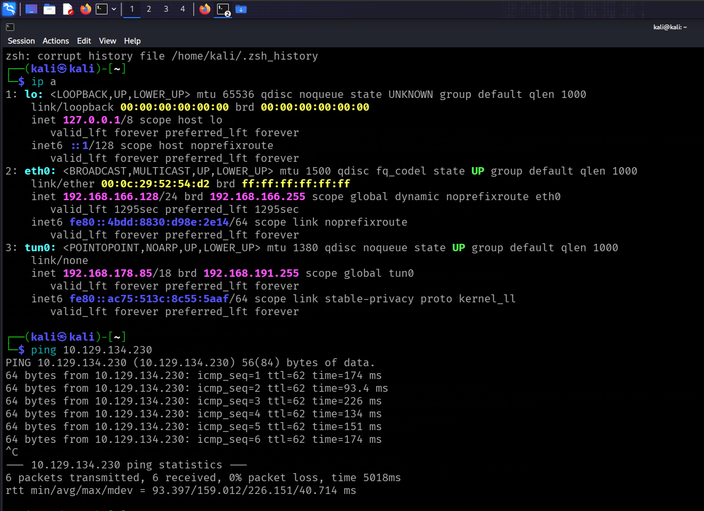

# 01 — Recon

## Overview

Before any scanning takes place, the first step of any engagement is confirming lab connectivity: verifying the attacking machine's network interfaces (including the VPN tunnel interface used to reach an isolated training range) and confirming the target host is alive and reachable.

## Objectives

- Confirm the attacking machine's network interfaces and assigned VPN address.
- Confirm the target host responds to ICMP and measure baseline latency.

## Important Terminology

| Term | Definition |
|---|---|
| Interface | A network endpoint (physical or virtual) on the host, e.g., `eth0`, `tun0` |
| `tun0` | A virtual point-to-point interface, typically created by a VPN client (e.g., OpenVPN), used to reach an isolated lab network |
| ICMP | Internet Control Message Protocol, used by tools like `ping` for reachability/diagnostic checks |
| RTT | Round-Trip Time — the time for a packet to travel to the target and back |

## Concepts Explained

A lab/training network is typically reached over a VPN tunnel rather than directly. Before scanning, it's good practice to confirm:

1. Which interface carries traffic to the lab range (usually a `tun0`-style interface).
2. That the interface has a valid IP address inside the expected lab subnet.
3. That the specific target IP is reachable before spending time on a full port scan.

## Commands and Syntax

### `ip a`

**Purpose:** List all network interfaces and their assigned addresses.

**Syntax:**
```bash
ip a
```

**Arguments:** None used.

**Explanation:** Displays every interface on the system (loopback, physical, and virtual/tunnel interfaces) along with IPv4/IPv6 addresses, state, and MTU.

**Observed Result:**
```text
2: eth0: <BROADCAST,MULTICAST,UP,LOWER_UP> mtu 1500 qdisc fq_codel state UP group default qlen 1000
    link/ether 00:0c:29:52:54:d2 brd ff:ff:ff:ff:ff:ff
    inet 192.168.166.128/24 brd 192.168.166.255 scope global dynamic noprefixroute eth0
3: tun0: <POINTOPOINT,NOARP,UP,LOWER_UP> mtu 1380 qdisc noqueue state UP group default qlen 1000
    link/none
    inet 192.168.178.85/18 brd 192.168.191.255 scope global tun0
```

**Why it was used:** To confirm the VPN tunnel (`tun0`) was active and had been assigned an address inside the training lab's subnet before attempting to reach the target.

### `ping`

**Purpose:** Confirm host reachability and measure round-trip latency.

**Syntax:**
```bash
ping <target-ip>
```

**Arguments:**

| Argument | Description |
|---|---|
| `<target-ip>` | The IP address of the host to test |

**Explanation:** Sends ICMP Echo Request packets and reports Echo Reply statistics (packet loss, min/avg/max/mdev round-trip time).

**Observed Result:**
```text
PING 10.129.134.230 (10.129.134.230) 56(84) bytes of data.
64 bytes from 10.129.134.230: icmp_seq=1 ttl=62 time=174 ms
64 bytes from 10.129.134.230: icmp_seq=2 ttl=62 time=93.4 ms
64 bytes from 10.129.134.230: icmp_seq=3 ttl=62 time=226 ms
64 bytes from 10.129.134.230: icmp_seq=4 ttl=62 time=134 ms
64 bytes from 10.129.134.230: icmp_seq=5 ttl=62 time=151 ms
64 bytes from 10.129.134.230: icmp_seq=6 ttl=62 time=174 ms

--- 10.129.134.230 ping statistics ---
6 packets transmitted, 6 received, 0% packet loss, time 5018ms
rtt min/avg/max/mdev = 93.397/159.012/226.151/40.714 ms
```

**Why it was used:** To confirm `10.129.134.230` was up and reachable before beginning port/service enumeration.

## Command Breakdown

| Component | Meaning |
|---|---|
| `ip` | The IP configuration utility |
| `a` | Shorthand for `address` — show addresses assigned to all interfaces |
| `ping` | ICMP reachability/latency test utility |
| `10.129.134.230` | Target IP address |

## Examples

```bash
ip a
ping 10.129.134.230
```

## Screenshots



## Observations

- The attacking machine reached the lab range via `tun0` (`192.168.178.85/18`), a typical OpenVPN-assigned tunnel address.
- The target `10.129.134.230` responded to ICMP with a TTL of `62`, consistent with a Linux host an additional hop or two away (default Linux TTL is usually `64`, decremented per hop).
- Round-trip time averaged ~159 ms with some jitter (mdev ~40 ms), indicating typical lab-VPN latency rather than a local network.

## Common Mistakes

- Forgetting to verify the VPN tunnel is up before scanning, leading to confusing "host down" results that are actually connectivity issues.
- Assuming ICMP is always enabled — some targets block ICMP while still being reachable on TCP/UDP services. Absence of a ping reply does not always mean the host is down.

## Notes

- A TTL of 62 was used later in enumeration to help interpret the `nmap` traceroute hop count (see [02 - Enumeration](../02-Enumeration/README.md)).

## Additional Context

> [!NOTE]
> The following is supplementary background, not part of the original lab notes.

Default initial TTL values vary by OS (commonly 64 for Linux, 128 for Windows, 255 for some network devices). Observing the *received* TTL and working backward (e.g., `64 - TTL_observed`) is a common heuristic for estimating hop count and can support OS fingerprinting when combined with other signals such as TCP/IP stack behavior.

## References

- [`ip`(8) man page](https://man7.org/linux/man-pages/man8/ip.8.html)
- [`ping`(8) man page](https://man7.org/linux/man-pages/man8/ping.8.html)

## Key Takeaways

- Always confirm VPN/tunnel connectivity before scanning a lab target.
- `ping` provides a fast, low-cost reachability and latency check before committing to a full scan.
- Observed TTL values are a useful (not definitive) signal for later OS fingerprinting.
