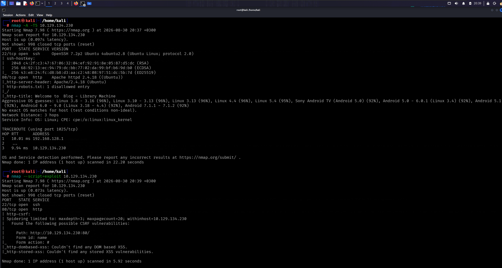

# 02 — Enumeration

## Overview

With connectivity confirmed, the next phase is service enumeration: identifying open ports, running services, service versions, and any obvious vulnerabilities Nmap's scripting engine (NSE) can surface without manual interaction.

## Objectives

- Identify all open TCP ports on the target and the services/versions bound to them.
- Run an aggressive scan to gather OS fingerprinting and default script (`-sC`-equivalent) output.
- Run NSE "exploit" category scripts to surface any low-hanging, automatable findings.

## Important Terminology

| Term | Definition |
|---|---|
| NSE | Nmap Scripting Engine — a framework for extending Nmap with Lua scripts for discovery, version detection, vulnerability detection, and exploitation |
| `-A` | Nmap aggressive mode: enables OS detection, version detection, script scanning, and traceroute |
| `-T5` | Nmap timing template 5 ("Insane") — fastest, least stealthy timing profile |
| CSRF | Cross-Site Request Forgery — a web vulnerability class where a victim's authenticated session can be tricked into submitting unintended requests |

## Concepts Explained

Nmap's `-A` flag bundles several forms of enumeration into a single scan: service/version detection, default NSE scripts, OS fingerprinting, and traceroute. This is a fast way to get a broad picture of a target before diving into manual service-specific enumeration.

The `--script=exploit` category runs any installed NSE script tagged as `exploit`, which can surface issues like CSRF-susceptible forms or basic XSS patterns without manual browser interaction — useful as a first pass, but not a replacement for manual review.

## Commands and Syntax

### Aggressive scan

**Purpose:** Discover open ports, service versions, OS guesses, and run default NSE scripts in one pass.

**Syntax:**
```bash
nmap -A -T5 <target-ip>
```

**Arguments:**

| Flag | Description |
|---|---|
| `-A` | Enables OS detection, version detection, default script scanning, and traceroute |
| `-T5` | Timing template 5 ("Insane") — fastest scan speed, higher chance of inaccuracy/detection |

**Explanation:** Combines multiple enumeration techniques into a single scan pass for speed during initial recon.

**Observed Result:**
```text
Starting Nmap 7.98 ( https://nmap.org ) at 2026-08-30 20:37 +0300
Nmap scan report for 10.129.134.230
Host is up (0.097s latency).
Not shown: 998 closed tcp ports (reset)
PORT   STATE SERVICE VERSION
22/tcp open  ssh     OpenSSH 7.2p2 Ubuntu 4ubuntu2.8 (Ubuntu Linux; protocol 2.0)
| ssh-hostkey:
|   2048 c4:2f:c3:47:67:06:32:04:ef:92:91:8e:05:87:d5:dc (RSA)
|   256 68:92:13:ec:94:79:dc:bb:77:02:da:99:bf:b6:9d:b0 (ECDSA)
|_  256 43:e8:24:fc:d8:b8:d3:aa:c2:48:08:97:51:dc:5b:7d (ED25519)
80/tcp open  http    Apache httpd 2.4.18 ((Ubuntu))
|_http-server-header: Apache/2.4.18 (Ubuntu)
| http-robots.txt: 1 disallowed entry
|_/
|_http-title: Welcome to  Blog - Library Machine
Aggressive OS guesses: Linux 3.8 - 3.16 (96%), Linux 3.10 - 3.13 (96%), Linux 3.13 (96%), Linux 4.4 (96%), Linux 5.4 (95%), Sony Android TV (Android 5.0) (92%), Android 5.0 - 6.0.1 (Linux 3.4) (92%), Android 5.1 (92%), Android 6.0 - 9.0 (Linux 3.18 - 4.4) (92%), Android 7.1.1 - 7.1.2 (92%)
No exact OS matches for host (test conditions non-ideal).
Network Distance: 3 hops
Service Info: OS: Linux; CPE: cpe:/o:linux:linux_kernel

TRACEROUTE (using port 1025/tcp)
HOP RTT     ADDRESS
1   10.01 ms 192.168.128.1
2   ...
3   9.94 ms  10.129.134.230

Nmap done: 1 IP address (1 host up) scanned in 22.20 seconds
```

**Why it was used:** To quickly enumerate open ports, running services, and their versions, and to get an initial content hint (`http-title`, `http-robots.txt`) for the web service.

### NSE exploit-category scan

**Purpose:** Run all installed NSE scripts tagged `exploit` against the discovered open ports.

**Syntax:**
```bash
nmap --script=exploit <target-ip>
```

**Arguments:**

| Flag | Description |
|---|---|
| `--script=exploit` | Runs every locally installed NSE script belonging to the `exploit` category |

**Explanation:** A broad NSE category scan used as an automated first pass for common, scriptable web issues (CSRF, DOM-based XSS, stored XSS) on top of the standard port scan.

**Observed Result:**
```text
Starting Nmap 7.98 ( https://nmap.org ) at 2026-08-30 20:39 +0300
Nmap scan report for 10.129.134.230
Host is up (0.073s latency).
Not shown: 998 closed tcp ports (reset)
PORT   STATE SERVICE
22/tcp open  ssh
80/tcp open  http
| http-csrf:
| Spidering limited to: maxdepth=3; maxpagecount=20; withinhost=10.129.134.230
|   Found the following possible CSRF vulnerabilities:
|
|     Path: http://10.129.134.230:80/
|     Form id: name
|_    Form action: #
|_http-dombased-xss: Couldn't find any DOM based XSS.
|_http-stored-xss: Couldn't find any stored XSS vulnerabilities.

Nmap done: 1 IP address (1 host up) scanned in 5.92 seconds
```

**Why it was used:** To check for common, automatically detectable web vulnerabilities (CSRF, DOM/stored XSS) before manual review of the web application.

## Command Breakdown

| Component | Meaning |
|---|---|
| `nmap` | The Nmap binary |
| `-A` | Aggressive scan bundle (OS/version/script/traceroute) |
| `-T5` | Insane timing template |
| `--script=exploit` | Run all NSE scripts in the `exploit` category |
| `10.129.134.230` | Scan target |

## Examples

```bash
nmap -A -T5 10.129.134.230
nmap --script=exploit 10.129.134.230
```

## Screenshots



## Observations

- Only two TCP ports were open: `22` (SSH, OpenSSH 7.2p2 on Ubuntu) and `80` (HTTP, Apache 2.4.18 on Ubuntu).
- The HTTP service's page title referenced a **"Library Machine"** and a blog application.
- `http-robots.txt` flagged a single disallowed entry in `robots.txt`, worth reviewing manually (see [03 - Web](../03-Web/README.md)).
- The OS fingerprint was inconclusive ("No exact OS matches"), but the SSH banner (`OpenSSH 7.2p2 Ubuntu`) strongly suggested an Ubuntu 16.04-era system.
- NSE flagged a **possible CSRF vulnerability** on a form (`id="name"`, `action="#"`) at the site root. No DOM-based or stored XSS was detected by the automated scripts — this does not rule out XSS entirely, only that these specific NSE heuristics found nothing.

## Common Mistakes

- Treating `--script=exploit` results as exhaustive; NSE's exploit-category scripts are heuristic and can both miss real issues and flag non-issues (e.g., a CSRF finding on a form with no real security-sensitive action).
- Relying solely on Nmap's OS guess percentages when "No exact OS matches" is reported — cross-reference with service banners (like the SSH version string) instead.
- Using `-T5` against production or sensitive targets; it is fast but noisy and more likely to be flagged by IDS/IPS or cause instability on fragile services. It was acceptable here only because this is an isolated training target.

## Notes

- The `http-title` output ("Welcome to Blog - Library Machine") and the `robots.txt` finding both directly informed the manual web review in [03 - Web](../03-Web/README.md).

## Additional Context

> [!NOTE]
> The following is supplementary background, not part of the original lab notes.

Nmap timing templates range from `-T0` (paranoid, used for IDS evasion) to `-T5` (insane). `-T5` assumes a fast, reliable, low-latency network and reduces timeouts/retries accordingly, which can produce false negatives on lossy networks. NSE's `exploit` category (as opposed to `vuln` or `safe`) specifically includes scripts capable of actively exploiting or actively testing for exploitable conditions, and should be used cautiously outside of authorized lab environments.

## References

- [Nmap Reference Guide](https://nmap.org/book/man.html)
- [Nmap NSE Script Categories](https://nmap.org/book/nse-usage.html#nse-categories)

## Key Takeaways

- A fast `-A -T5` scan is a good first pass for service/version/OS discovery.
- NSE `exploit`-category scripts are a useful automated triage step but must be followed up with manual verification.
- Small clues in scan output (page titles, `robots.txt` flags) should directly drive the next phase of manual enumeration.
