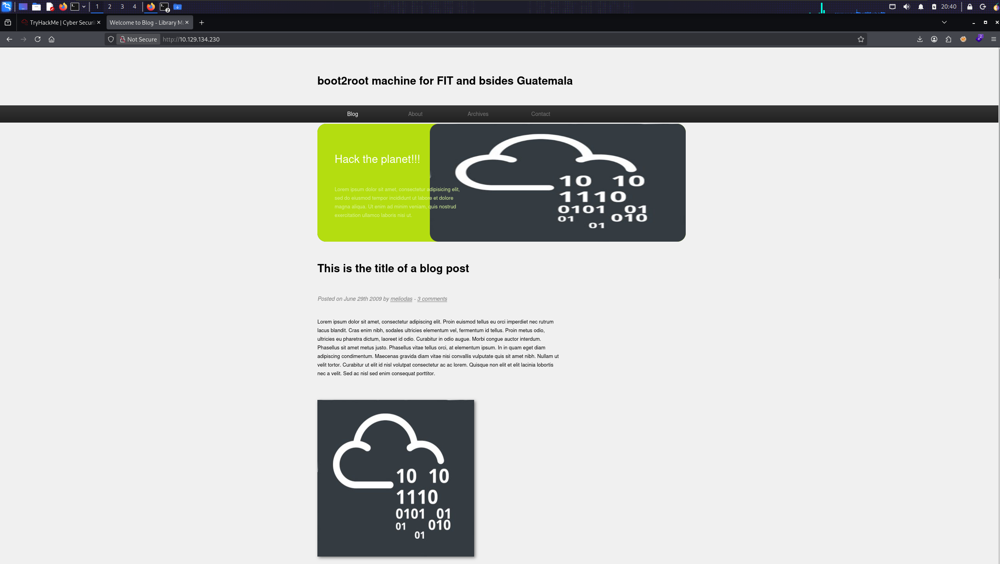
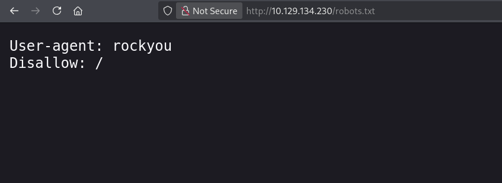
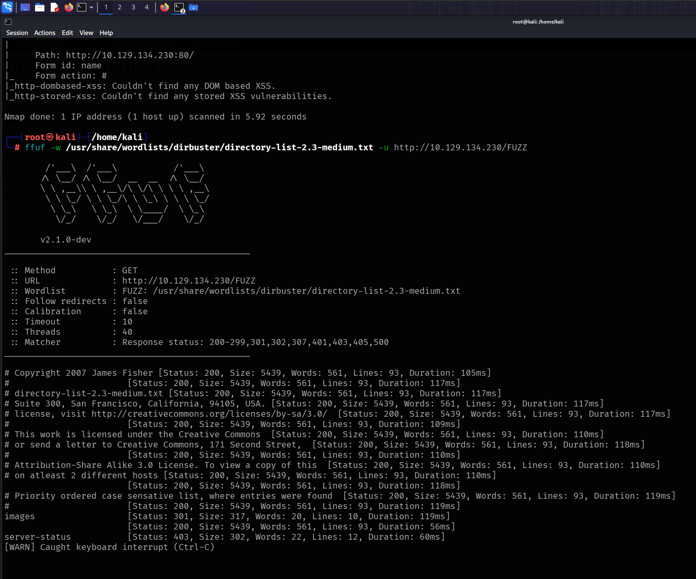
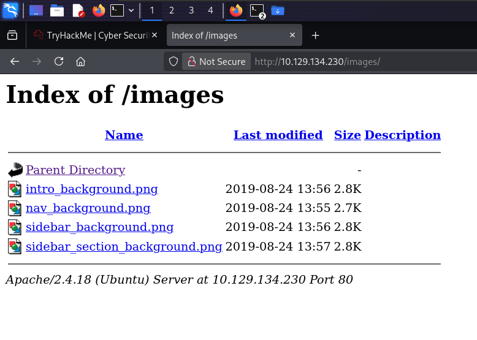

# 03 — Web

## Overview

The HTTP service on port 80 hosted a blog-style application. This phase covers manual review of the site, inspection of `robots.txt` (flagged during Nmap enumeration), directory content discovery with `ffuf`, and reviewing an exposed directory listing.

## Objectives

- Manually review the web application for identifying information (usernames, page structure, comments).
- Inspect `robots.txt` for disallowed paths or hints.
- Enumerate hidden/unlisted directories and files with `ffuf`.
- Review any exposed directory index for additional information.

## Important Terminology

| Term | Definition |
|---|---|
| `robots.txt` | A plaintext file at the web root that instructs web crawlers which paths not to index; it is advisory only and does not restrict access |
| Directory listing / autoindex | A web server feature that renders a browsable file index when no index file (e.g., `index.html`) is present in a directory |
| Content discovery / fuzzing | Systematically requesting a wordlist of candidate paths against a target to discover unlinked files and directories |
| Matcher / Filter | In fuzzing tools, rules used to include (matcher) or exclude (filter) responses from results, typically based on HTTP status code, response size, or word/line count |

## Concepts Explained

Blog-style applications often expose author usernames directly in post metadata ("Posted by \<user\>"), which is valuable for building a username list ahead of a credential attack. Combined with a `robots.txt` file that is unusually worded, this can be a strong hint pointing toward the next phase of an engagement.

Directory/content fuzzing complements manual browsing by requesting a large wordlist of common file and directory names against the target, revealing paths that are not linked from the visible site (like `/images/` or diagnostic endpoints such as `/server-status`).

## Commands and Syntax

### Manual browser review

**Purpose:** Identify application structure, usernames, and any visible metadata.

**Explanation:** The homepage rendered a blog titled **"boot2root machine for FIT and bsides Guatemala"**, with a single visible post titled "This is the title of a blog post," posted by user **`meliodas`**, with 3 comments.

**Why it was used:** To identify a valid username (`meliodas`) directly from the page content ahead of any credential-attack phase.

### `robots.txt` review

**Purpose:** Inspect the disallowed-entry hint flagged by Nmap's `http-robots.txt` script.

**Syntax:**
```text
http://10.129.134.230/robots.txt
```

**Observed Result:**
```text
User-agent: rockyou
Disallow: /
```

**Why it was used:** `robots.txt` is normally addressed to crawler user-agents (e.g., `Googlebot`). Here, the `User-agent` field was set to `rockyou` — a strong, deliberate hint toward using the `rockyou.txt` wordlist later in the engagement (see [05 - Credentials](../05-Credentials/README.md)).

### `ffuf` content discovery

**Purpose:** Discover unlinked directories/files on the web server.

**Syntax:**
```bash
ffuf -w /usr/share/wordlists/dirbuster/directory-list-2.3-medium.txt -u http://10.129.134.230/FUZZ
```

**Arguments:**

| Flag | Description |
|---|---|
| `-w <path>` | Path to the wordlist used to generate `FUZZ` candidates |
| `-u <url>` | Target URL, with `FUZZ` marking the injection point |

**Explanation:** `ffuf` substitutes each wordlist entry into the `FUZZ` marker and reports the HTTP status, response size, word count, and line count for each request, letting real content stand out from generic 404-style responses.

**Observed Result:**
```text
:: Matcher          : Response status: 200-299,301,302,307,401,403,405,500

images                 [Status: 301, Size: 317, Words: 20, Lines: 10, Duration: 119ms]
server-status           [Status: 403, Size: 302, Words: 22, Lines: 12, Duration: 60ms]
```

**Why it was used:** To surface directories not linked from the visible site. This revealed `/images/` (redirect to a directory index, HTTP 301) and `/server-status` (Apache's `mod_status` endpoint, HTTP 403 — present but access-restricted).

### Reviewing the exposed `/images/` directory index

**Purpose:** Inspect the contents of the discovered `/images/` directory.

**Syntax:**
```text
http://10.129.134.230/images/
```

**Observed Result:**
```text
Index of /images

Name                              Last modified      Size  Description
Parent Directory                  -
intro_background.png              2019-08-24 13:56    2.8K
nav_background.png                2019-08-24 13:55    2.7K
sidebar_background.png            2019-08-24 13:56    2.8K
sidebar_section_background.png    2019-08-24 13:57    2.8K

Apache/2.4.18 (Ubuntu) Server at 10.129.134.230 Port 80
```

**Why it was used:** Because `ffuf` returned a 301 for `/images`, the directory was reviewed directly in the browser. In this case, the exposed listing contained only static background images used by the site theme, with no further sensitive content.

## Command Breakdown

| Component | Meaning |
|---|---|
| `ffuf` | The fuzzing binary |
| `-w /usr/share/wordlists/dirbuster/directory-list-2.3-medium.txt` | DirBuster's medium wordlist, a common general-purpose content-discovery list bundled with Kali |
| `-u http://10.129.134.230/FUZZ` | Target URL with the fuzz injection point at the path segment |

## Examples

```bash
# Content discovery against the web root
ffuf -w /usr/share/wordlists/dirbuster/directory-list-2.3-medium.txt -u http://10.129.134.230/FUZZ
```

## Screenshots









## Observations

- The homepage directly disclosed a username (`meliodas`) via post authorship metadata.
- `robots.txt` was repurposed as an out-of-band hint (`User-agent: rockyou`) rather than a genuine crawler directive — an intentional clue rather than a real misconfiguration.
- `ffuf` surfaced two paths not linked from the visible site: `/images/` (open directory listing) and `/server-status` (present but returning `403 Forbidden`, indicating `mod_status` is enabled but access-restricted).
- The exposed `/images/` listing contained only cosmetic assets; no credentials or sensitive files were present there.
- Nmap's earlier `http-csrf` finding (see [02 - Enumeration](../02-Enumeration/README.md)) corresponds to the comment/name form visible on the blog post.

## Common Mistakes

- Skipping manual review of `robots.txt` because it "usually" just lists boilerplate crawler rules — in this case it was a deliberate, non-standard hint.
- Not following up on `ffuf` results with manual browser review; a 301 redirect to a directory alone doesn't tell you what's inside.
- Using a wordlist mismatched to the technology stack; a generic list found these two paths, but a CMS- or framework-specific wordlist might be needed for other targets.

## Notes

- The `rockyou` hint in `robots.txt` directly determined the wordlist choice used later for the SSH credential attack in [05 - Credentials](../05-Credentials/README.md).

## Additional Context

> [!NOTE]
> The following is supplementary background, not part of the original lab notes.

`robots.txt` is a convention respected by well-behaved crawlers, not an access control mechanism — anyone can request the file and see (or ignore) its contents. Using it to smuggle a hint (as with `User-agent: rockyou`) is a common CTF/training-lab pattern rather than something typically seen in production. Similarly, Apache's `mod_status` (`/server-status`) is a legitimate diagnostic feature that, if left world-readable, can leak internal request details; a `403` response indicates it is enabled but properly access-restricted.

## References

- [Apache mod_status documentation](https://httpd.apache.org/docs/2.4/mod/mod_status.html)
- [ffuf GitHub repository](https://github.com/ffuf/ffuf)
- [Google's robots.txt specification overview](https://developers.google.com/search/docs/crawling-indexing/robots/intro)

## Key Takeaways

- Manual review and automated fuzzing are complementary; each surfaced information the other did not.
- Non-standard use of standard files (like `robots.txt`) can be an intentional signal in training environments — always read the actual content, not just the finding type.
- A username harvested from application content is high-value input for the next phase of an engagement.
