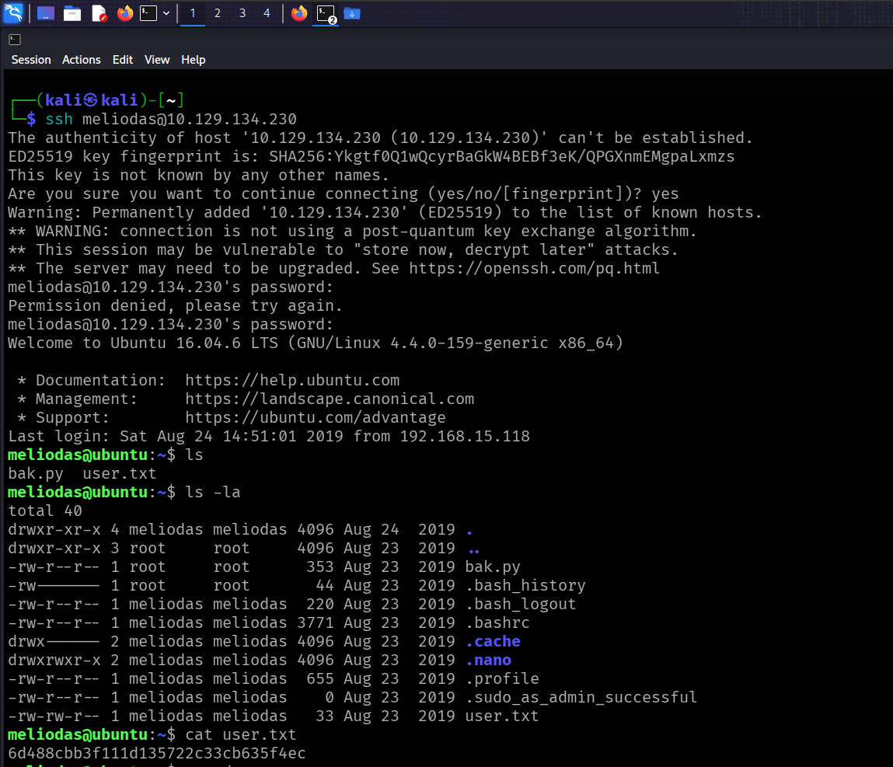

# 06 — Initial Access

## Overview

Using the credentials recovered in [05 - Credentials](../05-Credentials/README.md) (`meliodas:iloveyou1`), this phase covers authenticating over SSH, performing a first pass of local enumeration, and locating the user-level flag.

## Objectives

- Authenticate to the target via SSH using recovered credentials.
- Perform initial local enumeration of the home directory.
- Locate and read the user flag.

## Important Terminology

| Term | Definition |
|---|---|
| Host key fingerprint | A cryptographic fingerprint of the SSH server's public key, presented on first connection to help detect man-in-the-middle attacks |
| `known_hosts` | The client-side file (`~/.ssh/known_hosts`) that records trusted host key fingerprints for previously connected hosts |
| User flag | In training/CTF-style environments, a marker file (commonly `user.txt`) placed in a low-privilege user's home directory to confirm successful initial access |

## Concepts Explained

SSH verifies server identity via host key fingerprints. On first connection to a previously unseen host, the client prompts for explicit trust confirmation. This is a legitimate security control (not part of the "vulnerability" being tested here) and simply reflects a fresh client/target pairing typical of a lab environment.

## Commands and Syntax

### SSH authentication

**Purpose:** Establish an authenticated remote shell session using the recovered credentials.

**Syntax:**
```bash
ssh meliodas@10.129.134.230
```

**Arguments:**

| Component | Description |
|---|---|
| `meliodas@` | Username to authenticate as |
| `10.129.134.230` | Target host |

**Explanation:** Connects to the SSH daemon on the default port (22), prompting for host key trust on first connection, then for the account password.

**Observed Result:**
```text
The authenticity of host '10.129.134.230 (10.129.134.230)' can't be established.
ED25519 key fingerprint is: SHA256:Ykgtf0Q1wQcyrBaGkW4BEBf3eK/QPGXnmEMgpaLxmzs
This key is not known by any other names.
Are you sure you want to continue connecting (yes/no/[fingerprint])? yes
Warning: Permanently added '10.129.134.230' (ED25519) to the list of known hosts.
meliodas@10.129.134.230's password:
Permission denied, please try again.
meliodas@10.129.134.230's password:
Welcome to Ubuntu 16.04.6 LTS (GNU/Linux 4.4.0-159-generic x86_64)
Last login: Sat Aug 24 14:51:01 2019 from 192.168.15.118
```

**Why it was used:** To gain an authenticated shell as `meliodas` using the credentials recovered via the SSH dictionary attack.

> [!NOTE]
> The first password attempt returned "Permission denied" — this reflects the entry of an initial (incorrect) attempt before the correct, recovered password was supplied.

### Local enumeration

**Purpose:** List the contents of the newly accessed home directory, including hidden files.

**Syntax:**
```bash
ls
ls -la
```

**Observed Result:**
```text
meliodas@ubuntu:~$ ls
bak.py  user.txt
meliodas@ubuntu:~$ ls -la
total 40
drwxr-xr-x 4 meliodas meliodas 4096 Aug 24  2019 .
drwxr-xr-x 3 root     root     4096 Aug 23  2019 ..
-rw-r--r-- 1 root     root      353 Aug 23  2019 bak.py
-rw-------  1 root     root       44 Aug 23  2019 .bash_history
-rw-r--r-- 1 meliodas meliodas  220 Aug 23  2019 .bash_logout
-rw-r--r-- 1 meliodas meliodas 3771 Aug 23  2019 .bashrc
drwx------  2 meliodas meliodas 4096 Aug 23  2019 .cache
drwxrwxr-x 2 meliodas meliodas 4096 Aug 23  2019 .nano
-rw-r--r-- 1 meliodas meliodas  655 Aug 23  2019 .profile
-rw-r--r-- 1 meliodas meliodas    0 Aug 23  2019 .sudo_as_admin_successful
-rw-r--r-- 1 meliodas meliodas   33 Aug 23  2019 user.txt
```

**Why it was used:** Standard first step after gaining a foothold — identify what's in the accessible home directory before deeper enumeration. Two items stood out immediately: `bak.py` (owned by `root`, readable by the current user — investigated further in [07 - Privilege Escalation](../07-Privilege-Escalation/README.md)) and `user.txt`.

### Reading the user flag

**Purpose:** Confirm and record successful initial access.

**Syntax:**
```bash
cat user.txt
```

**Observed Result:**
```text
6d488cbb3f111d135722c33cb635f4ec
```

**Why it was used:** To confirm and document successful initial access to the target as a low-privilege user.

## Command Breakdown

| Command | Purpose |
|---|---|
| `ssh meliodas@10.129.134.230` | Authenticate over SSH with recovered credentials |
| `ls` / `ls -la` | Enumerate home directory contents, including hidden files |
| `cat user.txt` | Read the confirmed user-level flag |

## Examples

```bash
ssh meliodas@10.129.134.230
ls -la
cat user.txt
```

## Screenshots



## Observations

- The account `meliodas` had a valid interactive shell and standard home directory layout.
- `.sudo_as_admin_successful` being present suggested the account had used `sudo` successfully at some point — a strong hint to check `sudo -l` next (confirmed in [07 - Privilege Escalation](../07-Privilege-Escalation/README.md)).
- `bak.py` was owned by `root` but present directly in the user's home directory — worth reviewing both its contents and any associated `sudo` permissions.
- The target was running **Ubuntu 16.04.6 LTS** with kernel **4.4.0-159-generic**, consistent with the SSH banner (`OpenSSH 7.2p2 Ubuntu`) observed during enumeration.

## Common Mistakes

- Skipping a careful review of `ls -la` output (including hidden files) — `.sudo_as_admin_successful` and file ownership details are easy to miss with a plain `ls`.
- Not checking file ownership/permissions on every file in reach; a root-owned file sitting in a writable or otherwise-accessible location is a common privilege-escalation signal.

## Notes

- `bak.py`'s presence and ownership directly seeded the investigation in [07 - Privilege Escalation](../07-Privilege-Escalation/README.md).

## Additional Context

> [!NOTE]
> The following is supplementary background, not part of the original lab notes.

The `.sudo_as_admin_successful` file is created automatically by Ubuntu's `sudo` package the first time a user successfully authenticates with `sudo`; its mere presence (regardless of content, which is typically empty) is a reliable indicator that the account has `sudo` privileges for at least one command, making `sudo -l` a natural next enumeration step.

## References

- [OpenSSH manual](https://www.openssh.com/manual.html)

## Key Takeaways

- Always inspect hidden files during initial home-directory enumeration — they often contain strong hints about further privilege escalation paths.
- Confirming a flag/marker file is a useful checkpoint to validate that initial access was achieved as expected before moving on.
