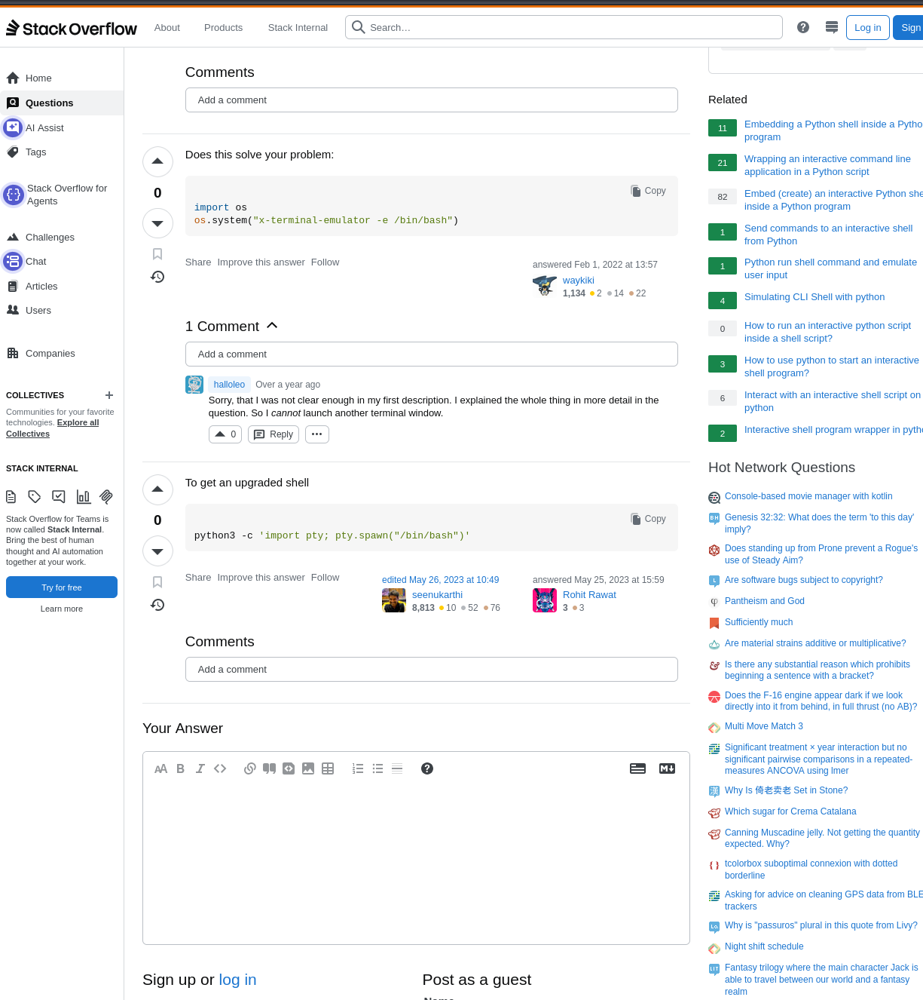

# External References

A list of external resources actually consulted while building this knowledge base, plus general further-reading material for the tools and techniques covered.

## Consulted During This Engagement

| Resource | Used For |
|---|---|
| [Stack Overflow — interactive Python shell / `pty.spawn` discussion](https://stackoverflow.com/questions/6203653) | Reference for the `pty.spawn("/bin/bash")` interactive-shell technique used in [`docs/07-Privilege-Escalation`](../docs/07-Privilege-Escalation/README.md) |

> [!NOTE]
> Only the general technique (using Python's `pty` module to spawn an interactive shell) was referenced — no text was reproduced from the page. See [`docs/07-Privilege-Escalation`](../docs/07-Privilege-Escalation/README.md) for the exact payload actually used.

## Further Reading

| Resource | Topic |
|---|---|
| [HackTricks](https://book.hacktricks.xyz/) | Broad offensive security methodology reference |
| [PayloadsAllTheThings](https://github.com/swisskyrepo/PayloadsAllTheThings) | Payloads and techniques across many vulnerability classes |
| [GTFOBins](https://gtfobins.github.io/) | Abusing Unix binaries for privilege escalation, once a relevant `sudo`/SUID binary is identified |
| [OWASP](https://owasp.org/) | Web application security standards and methodology |
| [Nmap Reference Guide](https://nmap.org/book/man.html) | Nmap usage and NSE reference |
| [`sudoers`(5) man page](https://man7.org/linux/man-pages/man5/sudoers.5.html) | `sudo` configuration syntax and semantics |

## Key Takeaways

- External references were used to confirm/inform technique choices, not to copy exploitation steps verbatim — every command actually run is documented with its own real output in the relevant `docs/` folder.
